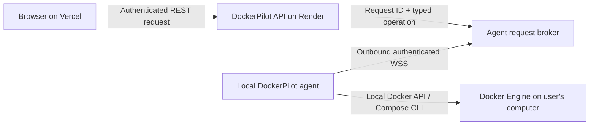

# Hosted Docker access through a local agent

## Goal

Let the hosted DockerPilot API manage the Docker Engine on a user's own computer without exposing a Docker socket or accepting inbound connections to that computer. The same design must support one agent for the current expo demo and separate agents for other users later.

## Connection shape

The browser continues to call the existing authenticated API. The local agent makes an outbound TLS WebSocket connection to the API, so it works behind NAT and does not require port forwarding, a public Docker socket, or a tunnel to the Docker API.

## Pairing and device identity

1. A signed-in user requests a pairing challenge from the API.
2. The API creates a cryptographically random, single-use challenge bound to that user, with a short expiry and strict attempt limits. Store only a hash of the challenge.
3. The local agent is given that challenge by the user and exchanges it over HTTPS for a device identity and random revocable credential. The challenge is consumed atomically.
4. The agent stores its credential in a private per-user file with restrictive file permissions. The API stores only a hash and the owning account ID.
5. The agent reconnects over WSS using its credential. Users can list and revoke devices from DockerPilot. Revocation closes any active connection.

Do not put the account's session cookie, JWT signing secret, Docker socket path, or Docker credentials in the agent credential or pairing flow. Pairing codes must not be accepted in URLs or logs.

## Request protocol

The API keeps authentication, project authorization, Compose validation, rate limits, and activity recording. It sends the connected agent a bounded request containing a unique request ID, expiry, and an operation from a closed allowlist. The agent returns a bounded JSON result or a safe error for that request ID.

The protocol must not carry shell text, arbitrary Docker API paths, or an unvalidated Compose file. Operations should express intent such as listing containers, inspecting a named resource, starting an owned container, pulling an image, collecting bounded logs, or applying a server-validated Compose deployment. The agent independently checks DockerPilot ownership labels before lifecycle changes or cleanup. Compose execution uses a generated configuration and fixed argument templates.

Set strict message-size, response-size, concurrency, and execution-time limits. Reject expired, duplicate, unknown, and malformed requests. Do not log credentials, raw Compose YAML, raw Docker errors, or secret values. A disconnected agent returns a clear unavailable response; it must never fall back to another user's Docker Engine.

## Persistence and account boundaries

Represent each agent as an account-owned device with created/last-seen/revoked timestamps and a hashed credential. Pairing challenges are single-use and expire. A user may later pair more than one device; each request is routed only to an active device owned by that authenticated account. The current product still treats one Docker daemon as one trusted operator's environment; account records do not isolate several users sharing that daemon.

## Rollout

1. Implement the schema, pairing API, revocation API, and protocol unit tests.
2. Implement the local agent process and an in-memory broker for one Render API instance. Keep the Render service at one instance until relay state has a shared store or durable broker.
3. Route Docker operations through typed agent operations while keeping local development's direct Docker connection intact.
4. Add a clear device connection state in the UI and verify the deployed Vercel-to-Render-to-local-Docker path on the expo Mac.
5. Document installation, pairing, update, revocation, reconnect, and troubleshooting steps before inviting other laptops.

Do not enable hosted Docker controls until the complete relay path, authorization checks, revocation, timeout behavior, and deployment configuration have been verified together.
