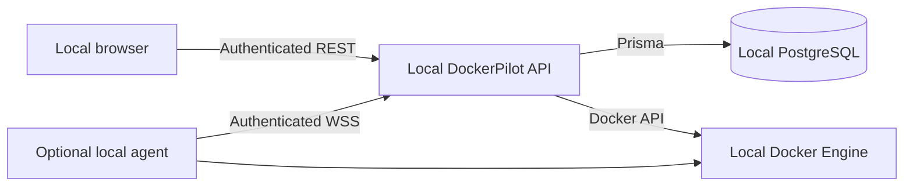

# Local architecture

DockerPilot is intended to run locally beside the Docker Engine it manages. The React app sends authenticated requests to the Express API. The API talks to PostgreSQL through Prisma and to Docker through Dockerode or the optional paired local agent. The browser never accesses the Docker socket.

The pairing code expires after five minutes, is consumed once, and is stored as a hash. The agent receives a revocable credential after code redemption and stores it in a private per-user file. Pairing command examples contain no credential. Agent traffic uses a typed operation allowlist. The local relay and rate limiter are process memory, so use one API process.

This is a single trusted operator setup. Application accounts do not isolate users sharing one Docker daemon. Lifecycle operations remain guarded by ownership labels, and AI Brain only reports observations and suggestions; it does not run commands or stop containers.

See [installation](installation.md), [operations](operations.md), and [local agent design](local-agent-design.md).
