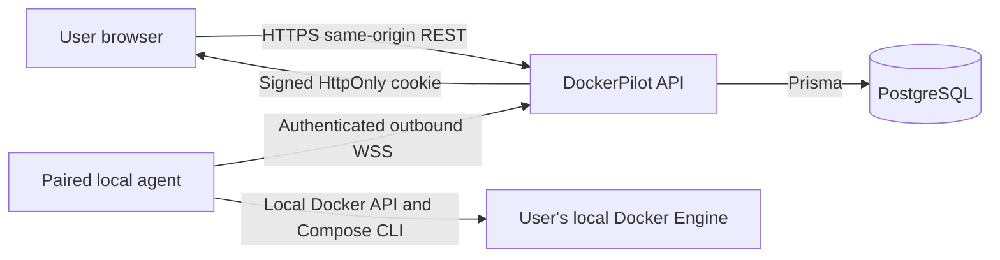

# Production architecture decision

## Current architecture

DockerPilot supports two execution modes. Local development/self-hosting can run the API beside a local Docker Engine. The hosted deployment uses `DOCKER_CONNECTION_MODE=agent`: the API keeps accounts, projects, and deployment records, while a paired local agent makes an authenticated outbound WSS connection and operates only its own computer's Docker Engine. The browser never receives a Docker socket path or daemon credential. Do not expose Docker's socket or an unauthenticated Docker API.

In agent mode, requests are routed using the authenticated account and only that account's agent connection. Project records are account-scoped, Compose deployment names derive from unique environment IDs, and destructive Compose operations verify account and Docker ownership labels. The current in-memory relay permits only one connected agent per account and requires one API instance. Do not run several accounts against one shared local Docker daemon in local mode; host-wide inventory in that mode is not an account boundary.

## Options considered

| Option | Security | Complexity | Cost and deployment | User experience |
| --- | --- | --- | --- | --- |
| Hosted frontend + hosted backend + local agent | Strong potential boundary if the agent initiates an authenticated outbound connection and accepts only typed, authorized operations. No public Docker socket. | High: pairing/revocation, command broker, replay protection, per-environment authorization, bounded streaming, reconnect, upgrades, and a transport boundary across every Docker service. | Hosted control plane plus agent distribution and support. | Best eventual public product: one shared web app with user-owned environments. |
| Hosted frontend + user-hosted backend | Docker can stay beside the user's backend, but the browser must reach that backend. Public HTTPS exposure of the management API creates a sensitive attack surface; same-site cookie and CORS constraints also complicate setup. | Medium initially, but secure ingress, TLS, origin configuration, upgrades, and remote access support remain user responsibilities. | Low hosted frontend cost; each user runs and exposes a server. | Friction and networking setup vary by user. |
| Self-hosted frontend + backend + database + Docker daemon together | Smallest attack surface when bound to loopback/private network and protected by an HTTPS proxy. Docker socket stays local to the trusted backend. | Lowest; matches current services and ownership checks. | Can run on an existing machine at no additional hosting charge; operator maintains backups and updates. | Reliable for local/private use, but does not provide a shared public SaaS. |

## Hosted agent mode and remaining limits

The hosted control plane pairs with a separately running local agent. Pairing uses a five-minute single-use code and a revocable credential. The server routes typed operations over an authenticated channel; the agent validates payloads and enforces its operation allowlist. Credentials are hashed by the API and stored with owner-only file permissions by the agent. The browser never supplies shell text, arbitrary Docker API paths, or a Docker socket.

The website now displays ordered Docker Desktop, Engine verification, agent preview, pairing, and developer database steps. Standalone Windows/macOS installers are not published, so current pairing still requires Git, Node.js, and a source checkout. Multiple computers per account, shared relay state, and multi-instance rate-limit storage are not implemented. See [Expo readiness](expo-readiness.md) before presenting this as a public SaaS.

## Production constraints

- One trusted operator per installation; do not treat application user records as tenant isolation for a shared Docker daemon.
- Use a same-origin reverse proxy for the web UI and API. Set `FRONTEND_ORIGIN` to that exact HTTPS origin.
- Keep PostgreSQL private and persistent; use the checked-in Prisma migrations and take tested backups.
- The current rate limiter stores counters in process memory. Run a single API process; multi-instance deployments require a shared store before launch.
- Registration is enabled and there is no administrator/tenant provisioning flow. Do not expose an instance for public self-registration.
- There is no secrets manager for user Compose values. Compose validation rejects environment/secret fields; do not put credentials in Compose text or logs.
- This repository has no `LICENSE` file. The repository owner must select and add a license before describing public distribution as open source.
