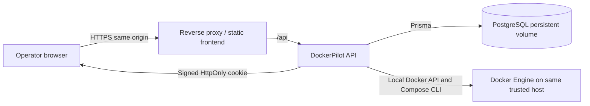

# Production architecture decision

## Decision for the current release

Use DockerPilot as a **single-operator, self-hosted installation**. Run the web frontend, API, PostgreSQL, and Docker Engine in the same trusted environment. A reverse proxy may provide HTTPS and serve the frontend and `/api` on the same origin. The browser never receives a Docker socket path or daemon credential. Do not expose the API or Docker socket directly to the public internet.

This is the only architecture the current code can safely support without changing its Docker execution model. The current API runs Dockerode and the Compose CLI directly against one local daemon. Some Docker inventories are host-wide, so application account separation does not currently provide per-user isolation over a shared daemon. Keep one trusted operator per DockerPilot installation and one Docker daemon per installation.

## Options considered

| Option | Security | Complexity | Cost and deployment | User experience |
| --- | --- | --- | --- | --- |
| Hosted frontend + hosted backend + local agent | Strong potential boundary if the agent initiates an authenticated outbound connection and accepts only typed, authorized operations. No public Docker socket. | High: pairing/revocation, command broker, replay protection, per-environment authorization, bounded streaming, reconnect, upgrades, and a transport boundary across every Docker service. | Hosted control plane plus agent distribution and support. | Best eventual public product: one shared web app with user-owned environments. |
| Hosted frontend + user-hosted backend | Docker can stay beside the user's backend, but the browser must reach that backend. Public HTTPS exposure of the management API creates a sensitive attack surface; same-site cookie and CORS constraints also complicate setup. | Medium initially, but secure ingress, TLS, origin configuration, upgrades, and remote access support remain user responsibilities. | Low hosted frontend cost; each user runs and exposes a server. | Friction and networking setup vary by user. |
| Self-hosted frontend + backend + database + Docker daemon together | Smallest attack surface when bound to loopback/private network and protected by an HTTPS proxy. Docker socket stays local to the trusted backend. | Lowest; matches current services and ownership checks. | Can run on an existing machine at no additional hosting charge; operator maintains backups and updates. | Reliable for local/private use, but does not provide a shared public SaaS. |

## Public multi-user architecture: future design, not implemented

The hosted control plane now pairs with a separately running local agent. The agent makes an outbound TLS connection, pairs through a short-lived single-use code, and receives narrowly typed operations over an authenticated channel. The server authorizes the account and environment on every request; the agent enforces a command allowlist and verifies resource ownership locally. Credentials are revocable, request IDs and expiries are checked, payloads and logs are bounded, operations have timeouts, and reconnects are supported. The browser never supplies shell text, arbitrary Docker API paths, or a Docker socket. Docker credentials are not stored at the control plane.

For the current single-computer expo setup, configure the hosted backend for agent mode and keep the agent running on the Mac during the presentation. Each additional user's computer must be paired separately from that user's signed-in account. Keep the API and agent software updated, and revoke lost or retired computers from the account's device list.

## Production constraints

- One trusted operator per installation; do not treat application user records as tenant isolation for a shared Docker daemon.
- Use a same-origin reverse proxy for the web UI and API. Set `FRONTEND_ORIGIN` to that exact HTTPS origin.
- Keep PostgreSQL private and persistent; use the checked-in Prisma migrations and take tested backups.
- The current rate limiter stores counters in process memory. Run a single API process; multi-instance deployments require a shared store before launch.
- Registration is enabled and there is no administrator/tenant provisioning flow. Do not expose an instance for public self-registration.
- There is no secrets manager for user Compose values. Compose validation rejects environment/secret fields; do not put credentials in Compose text or logs.
- This repository has no `LICENSE` file. The repository owner must select and add a license before describing public distribution as open source.
